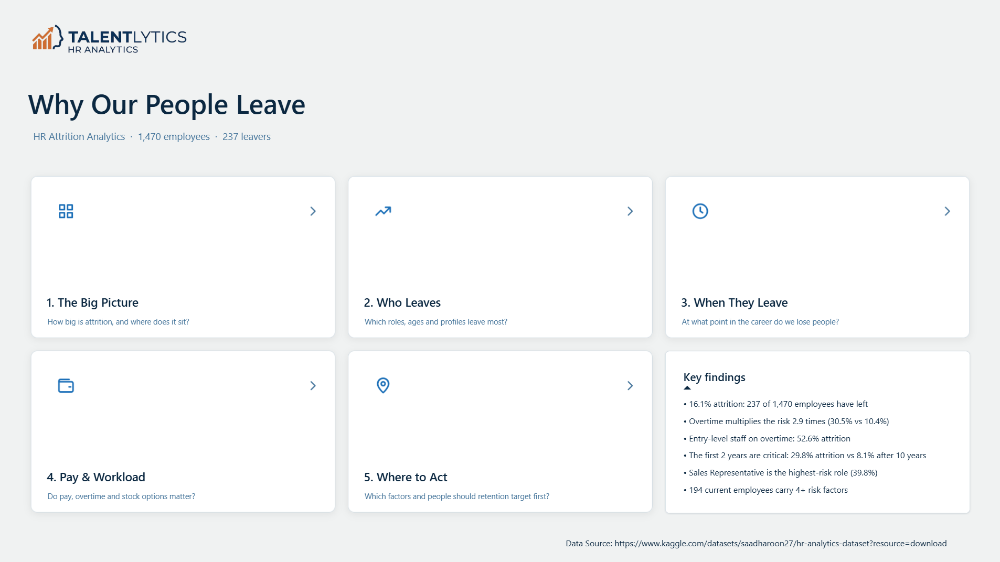
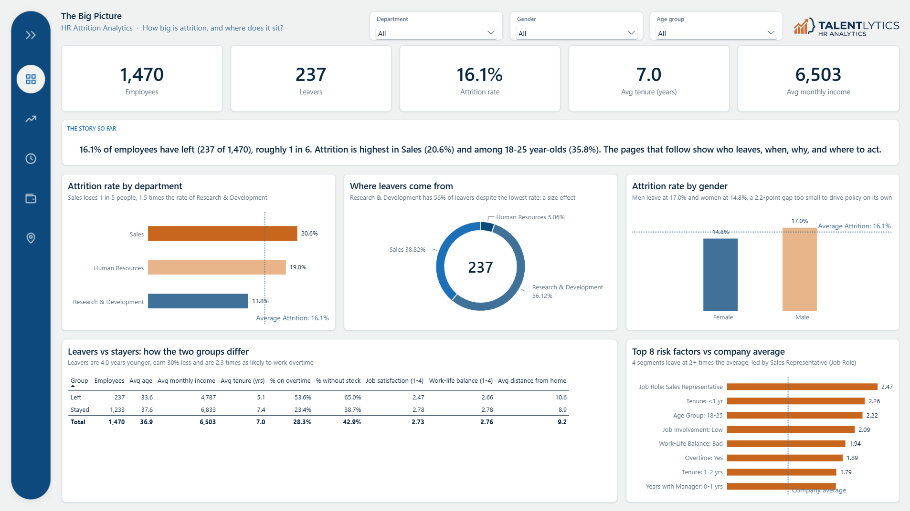
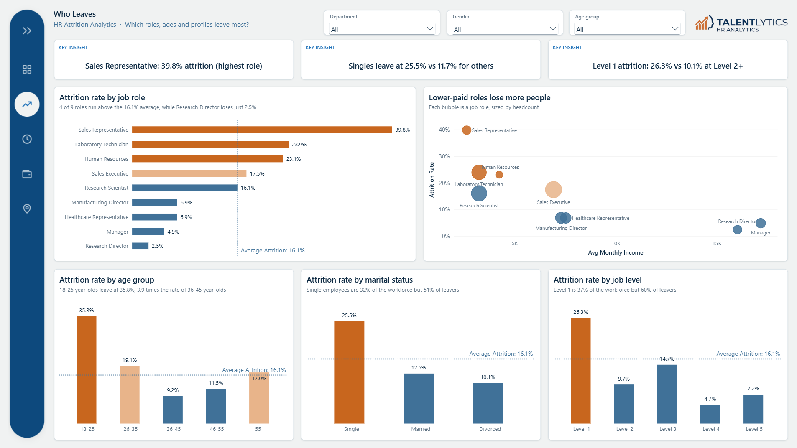
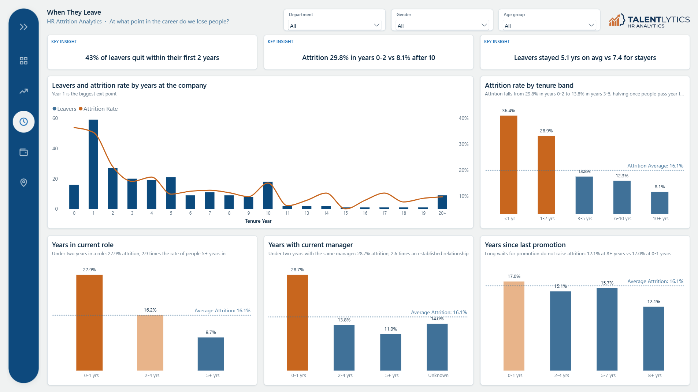
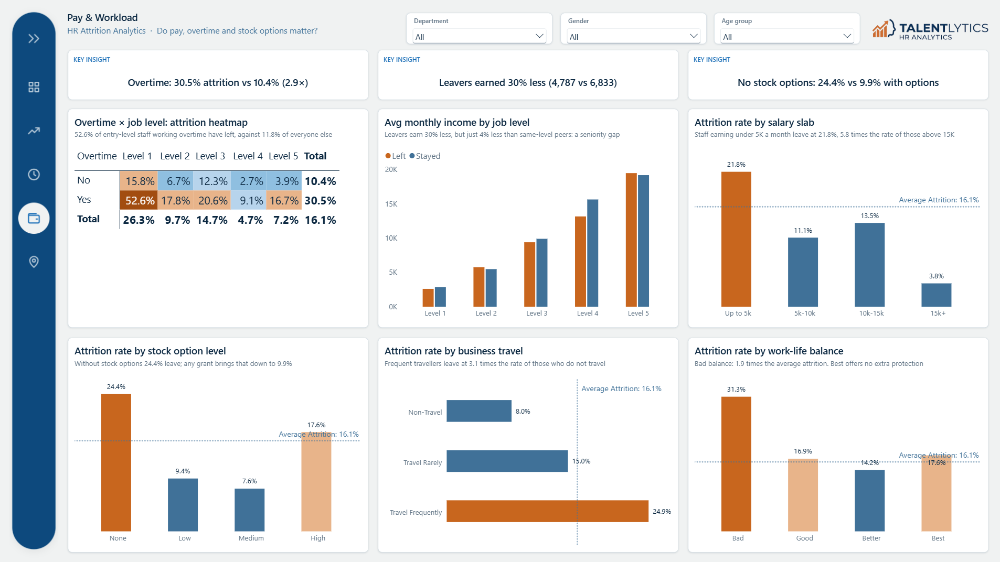
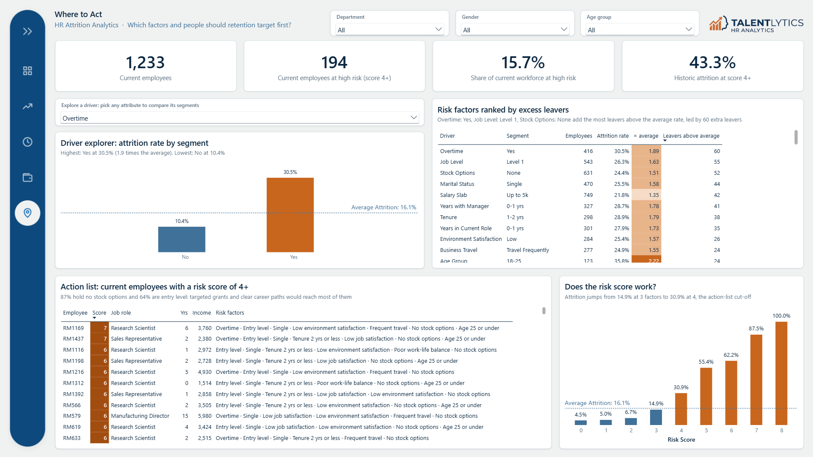

# Why Our People Leave: HR Attrition Analytics

A storytelling Power BI dashboard that explains employee attrition across 1,470 employees: how big the problem is, who leaves, when, why, and which current employees retention should focus on first.

Built as a **Power BI Project (PBIP)**, so the whole semantic model (TMDL) and report (PBIR) are plain text you can read right here on GitHub, no Power BI install needed.

## Key findings

On the full dataset:

- **16.1% attrition**: 237 of 1,470 employees have left.
- **Overtime nearly triples the risk**: 30.5% attrition vs 10.4% without overtime. Entry-level staff working overtime lose **52.6%**.
- **The first two years are critical**: 29.8% attrition in years 0-2, falling to 8.1% after 10 years. 43% of leavers quit within two years.
- **The pay gap is mostly seniority, not pay**: leavers earn 30% less overall but only about 4% less than peers at the same job level.
- **Stock options protect**: 24.4% attrition without them vs 9.9% with any grant.
- **194 current employees** carry four or more risk factors. Historically, 43% of people with that profile left.

## The story, page by page

| Page | Question it answers |
|---|---|
| **The Big Picture** | How big is attrition, and where does it sit? |
| **Who Leaves** | Which roles, ages and profiles leave most? |
| **When They Leave** | At what point in the career do we lose people? |
| **Pay & Workload** | Do pay, overtime and stock options matter? |
| **Where to Act** | Which factors and people should retention target first? |

### The Big Picture

### Who Leaves

### When They Leave

### Pay & Workload

### Where to Act

## What's under the hood

**Dynamic, insight-led subtitles.** Every chart subtitle is a DAX measure that states the takeaway, not how to read the chart. The figures *and* the wording respond to the Department, Gender and Age group slicers. For example, the promotion chart only says "long waits do not raise attrition" while the data supports it.

**One consistent reference point.** Bars turn orange when they sit above the average for the current selection, and an *Average Attrition* line drawn from the same measure (`Baseline Attrition Rate`, using `ALLSELECTED`) makes that visible on every chart. It's a true headcount-weighted rate, not an average of bar heights.

**Driver explorer.** A disconnected `Driver Segments` table lets you compare segments of any of 23 attributes from one dropdown. Measures route the selection to the right column with `SWITCH` + `TREATAS`, wrapped in `KEEPFILTERS` so page slicers still apply.

**Ranked risk factors.** Every segment of 30+ people is ranked by *leavers above average*: how many more people left than the company-wide rate would predict. This prioritises by impact, not just by rate.

**Risk score and action list.** A 10-factor risk index built in Power Query (overtime, entry level, tenure of two years or less, no stock options, and so on). A validation chart shows it separates people well: 4.5% attrition at score 0 vs 87.5% at score 7. It drives a list of current employees to start retention conversations with.

**Data preparation (Power Query).**
- Removes 10 duplicate employee records.
- Fixes an inconsistent `TravelRarely` category.
- Keeps 57 blank "years with manager" values as *Unknown*.
- Drops constant and meaningless columns.
- Builds ordered bands (tenure, distance, promotion gap and more) with proper sort orders.

**Model at a glance:** 4 tables (`Employees`, `Driver Segments`, `Key Findings`, `_Measures`) and 91 measures, organised into display folders.

## Setup

1. Install [Power BI Desktop](https://powerbi.microsoft.com/desktop/) (a recent version that supports Power BI Projects).
2. Clone or download this repository.
3. Open `HR Attrition.pbip`.
4. Point the data source at your copy of the repo: **Transform data → Edit parameters → `DataFolder`**, then set it to the folder containing `HR_Analytics Data Set.csv`.
5. Click **Refresh**.

## Data

[HR Analytics Dataset](https://www.kaggle.com/datasets/saadharoon27/hr-analytics-dataset) from Kaggle (1,480 rows, 38 columns, a fictional workforce). All credit for the data goes to its author.

## Built with

Power BI Desktop · Power Query (M) · DAX · TMDL / PBIR project format
